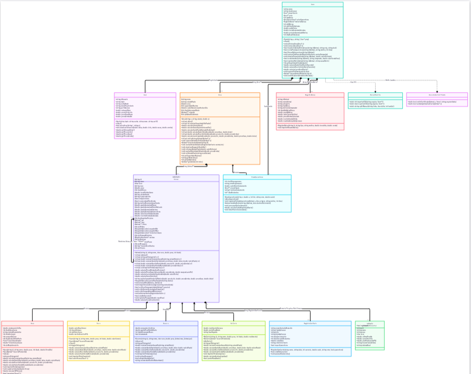

# 🐄 Sistema de Gestão - Fazenda Leiteira (FarmManager)


Projeto desenvolvido para a disciplina de **Programação Orientada a Objetos (INF 112)**, do curso de Ciência da Computação da **Universidade Federal de Viçosa (UFV)**.

O **FarmManager** é um sistema completo de gestão zootécnica, financeira, operacional e genealógica para propriedades rurais em **C++17** via terminal (CLI). Mais do que um cadastro de registros, o sistema aplica algoritmos de cálculo nutricional, penalização por superlotação de pastagens, projeção financeira (*Break-Even*), integração com APIs de cotação em tempo real, avaliação genética multi-geracional e apoio à decisão no manejo do rebanho.

---

## 🧠 O que diferencia o FarmManager de um gerenciador de registros comum?

Um gerenciador de registros tradicional apenas armazena e consulta dados (CRUD). O **FarmManager** processa os dados do rebanho para responder perguntas práticas do produtor e automatizar decisões de manejo:

1. **Planejamento de Gastos e Estoque de Ração (`Area`, `Farm`, `Animal`):**
   * Calcula polimorficamente o consumo diário individual de cada animal conforme peso vivo, categoria (`vaca`, `touro`, `boicorte`, `bezerro`) e fase produtiva (lactação, engorda, desmame/recria).
   * Converte o consumo em **sacos de ração por dia** e projeta a demanda para **30 dias**, separada por tipo (`Ração Engorda`, `Ração Avulsa` e `Ração Recria`), além do custo diário em reais (`R$`).
2. **Controle de Lotação e Penalidade Financeira por Superlotação (`Area`):**
   * Calcula a capacidade máxima de cabeças/hectare conforme a qualidade do pasto (`seco` = 0,5; `ruim` = 1,0; `intermediario` = 2,0; `bom` = 3,0; `muito bom` = 4,0 — com normalização e validação de entrada) e exibe a taxa de ocupação percentual.
   * **Impacto real no custo com teto fisiológico:** quando uma área ultrapassa **100% da capacidade**, `Area::calcularFatorSuperlotacao()` aplica um **fator multiplicador proporcional (`lotação / 100.0`) limitado ao teto fisiológico de `2,0x`** sobre o consumo de sacos e sobre o gasto diário de ração dos animais daquela área, simulando o aumento de suplementação em pasto superlotado sem distorcer fisicamente a capacidade de ingestão.
3. **Análise Financeira e Ponto de Equilíbrio (*Break-Even*):**
   * Cruza a receita diária estimada (produção de leite, ganho de peso com ágio por sexo/idade e rendimento de carcaça) contra o gasto diário com alimentação e manejo.
   * No relatório de *Break-Even* (`emitirRelatorioBreakEvenEVendas`), informa se o caixa já está positivo, **quantos dias faltam no ritmo atual para empatar o caixa**, ou alerta quando a operação diária está no prejuízo.
4. **Algoritmo de Score Genético em $O(N \log N)$ (`Farm::recalcularScoresGeneticos`):**
   * Modularizado em 4 etapas claras (`coletarAnimaisVivosOrdenados`, `atualizarAncestraisComVinculo`, `calcularAjusteDeDescendentes` e `aplicarScoresFinais`), ordena os arrays dinâmicos brutos de animais vivos e `SnapshotAncestral` com `std::sort` (`<algorithm>`) e realiza cruzamentos via **Busca Binária** (sem coleções da STL como `std::vector`), escalando com eficiência para milhares de animais.
   * Calcula o `scoreBase` (0 a 100) ponderando peso atual vs. peso esperado para a idade, ganho médio diário e indicador produtivo (leite na vaca — preservando a última produção conhecida `ultimaProducaoLeiteDia` durante o período seco sem gerar receita — e rendimento de carcaça no boi de corte).
   * Ajusta o `scoreGenetico` percorrendo recursivamente até **3 gerações de ancestrais** (com decaimento de peso `0,5` por geração), somando a contribuição de **todos os descendentes** ($\ge 6$ meses, inclusive já vendidos/removidos) em relação à média do rebanho e aplicando penalidade quando falta histórico genealógico.
   * Mantém a tabela compartilhada de ancestrais enxuta via coleta/limpeza recursiva (`limpezaDeAncestrais`), preservando apenas registros ligados a animais vivos na fazenda.
5. **Valoração de Mercado Proporcional ao Score e Rankings Personalizados (`Animal::calcularValorVendaSugerido`, `Farm`):**
   * Cada animal possui o atributo `valorVendaSugerido` e o método polimórfico `calcularValorVendaSugerido(precoArroba, precoLeite)`, que calcula o valor sugerido de venda com base no peso/arroba, produção leiteira/prenhez (vacas), rendimento/acabamento (bois de corte), ágio de idade/sexo (bezerros) ou banco de sêmen (touros), multiplicados pelo fator genético `Animal::getFatorPrecoGenetico()` (`0,85 + 0,003 × scoreGenetico`, gerando de `-12%` a `+15%` conforme o score).
   * O sistema oferece rankings de tamanho personalizado **Top N** ordenados com `std::sort` tanto por **Score Genético** (`listarTopAnimaisPorScore`) quanto por **Valor de Venda Sugerido** (`listarTopAnimaisPorValorVenda`).
6. **Apoio à Decisão Reprodutiva e de Maturidade:**
   * **Bloqueio de consanguinidade (`Vaca::emprenhar`):** impede coberturas entre parentes próximos (mesmo pai, mesma mãe ou relação pai/filha e mãe/filho) e valida idade mínima reprodutiva (15 meses) e status de quarentena.
   * **Recomendação automática na promoção (`Bezerro::recomendarDestinoMaturidade` & `Area::promoverAnimal`):** ao atingir 12 meses, fêmeas são direcionadas para `vaca` e machos são recomendados para `touro` (se `scoreGenetico >= 60`) ou `boicorte` (caso contrário). Durante a promoção, `Animal::copiarEstadoParaPromocao` preserva estado de saúde, temperamento, quarentena, `idPai`, `idMae`, filhos e dados de score genético na nova categoria.

---

## 🧭 Fluxo Completo do Sistema e Funcionalidades (`main.cpp`)

Ao executar o sistema, o usuário percorre três níveis de navegação:

### 1. Módulo de Acesso e Usuários (`moduloLogin`)
* **Primeiro acesso:** caso não existam usuários cadastrados, o sistema guia o cadastro do primeiro usuário (login, senha, nome do proprietário e cargo).
* **Login e Cadastro:** permite autenticar usuários existentes ou criar novas contas. As senhas são armazenadas com hash (`User::gerarHash`), nunca em texto puro.
* **Isolamento por proprietário:** cada usuário possui suas próprias fazendas e suas próprias configurações de cotações e preços de ração.

### 2. Seleção de Propriedade (`menuMinhasFazendas`)
Após o login, o proprietário pode:
* Listar todas as suas fazendas cadastradas (exibindo nome, localização e dia atual).
* Abrir/carregar uma fazenda existente.
* Criar uma nova fazenda (já associada ao usuário logado).
* Fazer logout e retornar à tela de login.

### 3. Painel de Gestão da Fazenda
Com a fazenda aberta, o menu principal oferece:

* **`[1] Relatórios` (`menuRelatorios`):**
  * *Relatório Operacional:* total do rebanho por categoria, receita/gasto/lucro diário e consumo diário e mensal (30 dias) de sacos de ração.
  * *Relatório de Caixa e Break-Even:* saldo em caixa, total acumulado em vendas, prejuízo acumulado, lucro diário e estimativa de dias para atingir o ponto de equilíbrio.
  * *Ranking Top N Animais por Score Genético:* exibe os `N` animais com maior `scoreGenetico` (posição `#1`, `#2`..., ID, tipo, área, peso, idade, filhos, score e valor de venda).
  * *Ranking Top N Animais por Valor de Venda:* exibe os `N` animais com maior `valorVendaSugerido` (posição `#1`, `#2`..., valor sugerido em `R$` e score).
* **`[2] Gerenciar Áreas` (`menuGerenciarAreas`):**
  * Listar áreas/pastos (com hectares, estado do pasto, lotação atual/máxima e contagem por tipo de animal), criar nova área (com normalização e validação do estado do pasto), selecionar área ativa e listar seu rebanho, editar estado do pasto ou hectares, consultar resumo de gasto e sacos de ração da área e remover áreas vazias.
* **`[3] Gerenciar Animais` (`menuGerenciarAnimais`):**
  * Adicionar `Vaca`, `Touro`, `Boicorte` ou `Bezerro` na área atual (com geração automática de IDs `VC`, `TR`, `BC`, `BZ` e validação de peso, idade, vacinas, valores e sexo `M`/`F`).
  * Buscar animal por ID (exibe ficha completa, área real e lotação via `Farm::buscarAreaDoAnimal`, lista/quantidade de filhos registrados, gasto diário individual com fator de superlotação e `valorVendaSugerido` atualizado).
  * Atualizar fase produtiva (lactação e produção de leite, fase de engorda ou desmame com verificação efetiva de mudança de estado).
  * Remover animal (venda, morte ou saída), apagando automaticamente o registro órfão do `.txt` da espécie.
  * Consultar genealogia (árvore de ancestrais e lista de filhos, ativos ou históricos).
* **`[4] Movimentação e Reprodução` (`menuMovimentacaoReproducao`):**
  * Transferir um animal ou um lote de animais entre áreas.
  * Realizar cobertura (`Touro x Vaca`) com validação de parentesco e idade.
  * Registrar nascimento (cria o bezerro na área escolhida, vincula pai/mãe e atualiza scores genéticos).
  * Promover bezerros elegíveis ($\ge 12$ meses) com recomendação automática de destino, preservação completa de estado/genética e remoção do registro antigo em `bezerros.txt`.
  * Recalcular manualmente os scores genéticos de todo o rebanho.
* **`[5] Cotações e Rações` (`menuCotacoesRacoes`):**
  * Visualizar valores atuais (dólar, litro do leite, arroba do boi, arroba da vaca, peso e preço das sacas de ração).
  * **Atualização via APIs + Manual:** busca automaticamente a cotação do dólar (`economia.awesomeapi.com.br`) e da arroba do boi/vaca (`agrodocai.com.br/api/v1/cotacao`) via `curl` com parser próprio de JSON, solicitando em seguida os valores locais de leite e rações com validação de números positivos.
  * **Edição individual:** permite alterar manualmente qualquer um dos 10 parâmetros de mercado e salvar imediatamente.
* **`[6] Importar Lote (.txt)`:**
  * Importa áreas (`AREA`), animais (`ANIMAL`) e registros históricos (`ANCESTRAL`) a partir de arquivos de texto estruturados, recalculando os scores genéticos e salvando ao final. Também é possível passar o caminho do arquivo diretamente como argumento na linha de comando (`./bin/main arquivo.txt`).
* **`[7] Salvar Tudo Agora` / `[8] Trocar de Fazenda` / `[0] Salvar e Voltar ao Login`:**
  * Persistência explícita e automática dos dados da fazenda e do usuário.

---

## 📄 Guia Completo de Entrada de Dados e Importação em Lote (`.txt`)

O sistema aceita dados por **três vias**:
1. **Menus interativos da CLI** (cadastro um a um pelo teclado).
2. **Importação em lote via arquivo `.txt`** (tanto arquivos pequenos quanto massas gigantes de stress), acionada pelo menu `[6] Importar Lote (.txt)` ou direto na linha de comando (`./bin/main caminho_do_arquivo.txt`).
3. **Persistência automática em `./data/*.txt`** *(gerenciada internamente pelo programa — não deve ser editada manualmente como arquivo de lote)*.

### Como montar um arquivo de importação em lote (`.txt`)
A função `importarArquivoEmLote()` lê linha a linha ignorando linhas em branco e comentários iniciados por `#`. Há **3 comandos aceitos**:

1. **`AREA`** — cria uma área/pasto (se ainda não existir na fazenda):
```text
AREA <nome_area> <estado_pasto_com_underscore> <hectares>
```
2. **`ANCESTRAL`** — registra parentes ou filhos históricos já vendidos/mortos (exatamente **8 campos** no formato plano de `SnapshotAncestral::ler()`):
```text
ANCESTRAL <id> <sexo_M_F_ou__> <peso> <idade_meses> <status> <score_base> <idPai_ou__> <idMae_ou__>
```
3. **`ANIMAL`** — adiciona um animal vivo na área (com genealogia opcional ao final da linha):
```text
ANIMAL <area> vaca     <ID|AUTO> <peso> <idade_meses> <em_lactacao_0_ou_1> <litros_dia> [idPai idMae [snapPai_8_campos] [snapMae_8_campos]]
ANIMAL <area> touro    <ID|AUTO> <peso> <idade_meses> <valor_dose_semen>                 [idPai idMae [snapPai_8_campos] [snapMae_8_campos]]
ANIMAL <area> boicorte <ID|AUTO> <peso> <idade_meses> <em_engorda_0_ou_1> <rendimento>   [idPai idMae [snapPai_8_campos] [snapMae_8_campos]]
ANIMAL <area> bezerro  <ID|AUTO> <sexo_M_ou_F> <peso> <idade_meses> <desmamado_0_ou_1>  [idPai idMae [snapPai_8_campos] [snapMae_8_campos]]
```

### Exemplo prático comentado
```text
AREA Pasto1 muito_bom 80.0
ANCESTRAL TR00 M 920.00 84 vendido 86.00 _ _

ANIMAL Pasto1 touro TR1 880.00 48 150.00 TR00 _
ANIMAL Pasto1 vaca VC1 560.00 42 1 26.50
ANIMAL Pasto1 bezerro AUTO M 185.00 8 1 TR1 VC1
```

### Regras importantes sobre IDs, pais e filhos na importação
* **`AUTO` vs. ID explícito:** `AUTO` gera automaticamente o próximo ID (`VC`, `TR`, `BC`, `BZ`). Quando outros animais da mesma importação precisarem referenciar aquele animal como `idPai` ou `idMae`, utilize **ID explícito** (ex.: `TR1`, `VC1`) e evite `_` em IDs/nomes.
* **Vinculação automática de filhos (`qtdFilhos` / `idFilhos`):** não é necessário listar filhos na linha dos pais — ao informar `idPai` e `idMae` nos filhos (sejam animais vivos `ANIMAL` ou históricos `ANCESTRAL`), o método `Farm::sincronizarFilhosNosPais()` popula automaticamente `idFilhos` e `qtdFilhos` em todos os pais vivos (inclusive se os filhos aparecerem antes dos pais no arquivo).
* **Validação em massa (teste de stress):** para validar o comportamento e o desempenho em $O(N \log N)$, geramos um arquivo de teste em lote com **10 áreas** (incluindo áreas superlotadas), **~20.000 animais vivos** e **~1.980 registros `ANCESTRAL`**, cobrindo **4 a 5 gerações** (trisavós, bisavós, avós, pais, filhos e netos), linhagens contrastantes (*Elite*, *Mediana* e *Fraca*), descendentes históricos vendidos/mortos e animais sem histórico ancestral.

---

## 💾 Persistência de Dados

Todos os dados do sistema são salvos localmente no diretório `./data/` em arquivos `.txt` estruturados, sem dependência de banco de dados externo:

* `./data/usuarios.txt` — credenciais (hash da senha), perfil, cotações e preços/pesos de ração por usuário.
* `./data/fazendas.txt` — metadados das fazendas, saldos financeiros, dia da simulação e próximo ID global.
* `./data/areas.txt` — áreas/pastos de cada fazenda e vínculo dos animais alocados.
* `./data/vacas.txt`, `./data/touros.txt`, `./data/boicortes.txt`, `./data/bezerros.txt` — dados específicos de cada categoria animal (incluindo o histórico `ultimaProducaoLeiteDia` em `vacas.txt` com leitura retrocompatível).
* `./data/ancestrais.txt` — tabela compartilhada de `SnapshotAncestral` para consulta genealógica e cálculo genético mesmo após venda/remoção de parentes.

**Como funciona o salvamento:**
* Alterações feitas nos menus de áreas, animais e movimentação/reprodução marcam a sessão para **salvamento automático** ao retornar ao painel principal (inclusive em caso de exceção tratada após alteração).
* **Salvamento otimizado em 1 passada por espécie:** `Farm::salvarFazenda()` utiliza o método polimórfico `Animal::escreverLinhaArquivo()` em `salvarAnimaisPorTipoEmLote()`, preservando dados de outras fazendas/usuários e reescrevendo cada arquivo de espécie apenas uma vez (permitindo recalcular scores e salvar 5.000 animais em fração de segundo).
* **Sem registros órfãos:** ao remover um animal (`Area::removerAnimal`) ou promover um bezerro (`Area::promoverAnimal`), o registro correspondente é removido do arquivo `.txt` da categoria anterior.
* Importações em lote, edições de cotações, troca de fazenda e logout também salvam os dados automaticamente.
* A gravação em disco utiliza arquivos temporários (`*_temp.txt` / `*.tmp`) antes de substituir o arquivo final, evitando corrupção em caso de falha durante a escrita.

---

## 🏛️ Arquitetura, Estrutura do Projeto e Status dos Módulos

O projeto foi construído sob restrições acadêmicas de POO em C++17 com foco no domínio de ponteiros e memória:

* **Sem coleções da STL (`std::vector`, `std::list`, `std::map`):** toda agregação utiliza **arrays dinâmicos manuais** (`Animal**`, `Area**`, `SnapshotAncestral*`, `std::string*`, `SacaRacao**`, `RegistroSanitario**`) com realocação e liberação rigorosa nos destrutores.
* **Polimorfismo:** classe abstrata `Animal` com métodos virtuais puros especializados em `Vaca`, `Touro`, `Bezerro` e `Boicorte`.

### Estrutura do Repositório
```text
.
├── include/            # Cabeçalhos (.hpp) das classes de domínio e sistema
├── src/                # Implementações (.cpp) e ponto de entrada (main.cpp)
├── data/               # Arquivos de persistência local (.txt)
├── docs/               # Diagrama UML de classes (PDF e PNG)
├── build/              # Objetos compilados (.o)
├── bin/                # Executável final (main)
└── Makefile            # Automação de build com g++ (-std=c++17)
```

### Status dos Módulos
* **Ativos e integrados na CLI (`main.cpp`):** `User`, `Farm`, `Area`, `Animal`, `Vaca`, `Touro`, `Bezerro`, `Boicorte`, `SnapshotAncestral`, `SacaRacao`.
* **Implementados no código (prontos para integração futura aos menus):** `Medicamento`, `RegistroSanitario`, `HistoricoSanitario` e `RegistroBaixa`.
* **Comentados/desativados nesta versão:** `AreaQuarentena`, `GerenciadorCertificado` (`certificado.hpp/cpp`) e `ParserPlanilha` (`parserplanilha.hpp/cpp` — substituído pelo fluxo de importação em lote no `main.cpp`).

---

## 👥 Equipe e Divisão de Responsabilidades

* **Paulo Vitor**
  * Estrutura geral do projeto e `Makefile`.
  * Implementação de `Farm`, `Area`, `User` (cotações/API e `sacaRacao.hpp`), trânsito/adição/remoção de animais e integração entre `Farm`, `Area` e `User`.
  * Leitura e escrita de arquivos (`Farm`, `Area` e subclasses de `Animal`), refatoração do `SnapshotAncestral` (`ancestrais.txt`), testes de carga em massa e correção de bugs e vazamentos de memória.
  * Participação na lógica do score genético, na importação em lote e em ajustes na `main.cpp`.

* **Vitor**
  * Implementação da classe base `Animal` e suas subclasses (`Vaca`, `Touro`, `Bezerro`, `Boicorte`), seus métodos e persistência circular dos dados.
  * Desenvolvimento de ~90% da interface CLI (`main.cpp`).
  * Participação na lógica do score genético e na importação em lote.

* **Marco Tulio**
  * Implementação base do `SnapshotAncestral` e participação na lógica do score genético.
  * Evolução final do relatório de *Break-Even*, integração dos gastos sanitários ao cálculo de gastos da `main` e módulo de certificado (`certificado.hpp`/`certificado.cpp`).

* **Elioenai**
  * Motor do tempo e parser de planilhas Excel/CSV (`parserplanilha.hpp`/`parser.cpp`) para conversão em dados legíveis pelo sistema.

* **Rhuan**
  * Módulo sanitário completo, controle de quarentena, saúde animal e registro de baixas (`Medicamento`, `RegistroSanitario`, `HistoricoSanitario`, `AreaQuarentena`, `RegistroBaixa`).

* **Equipe (Geral)**
  * Modelagem UML (`docs/Diagrama_Classes_FarmManager.pdf`).

---

## 💻 Diagrama Arquitetural de Classes

<div align="center">
  <a href="docs/Diagrama_Classes_FarmManager.pdf" target="_blank">
    
  </a>
  <br>
  <p>
    <i>Clique na miniatura acima para abrir a modelagem UML, ou <a href="docs/Diagrama_Classes_FarmManager.pdf">baixe o arquivo PDF aqui</a>.</i>
  </p>
</div>

---

## 🛠️ Como Compilar, Executar e Testar

### Pré-requisitos
* Compilador `g++` (GCC com suporte a C++17) e `make`.
* `curl` instalado no sistema (opcional, apenas para atualização automática das cotações via API).

### Compilação e Execução
No diretório raiz do projeto:

```bash
# Compilar o projeto (gera ./bin/main)
make

# Executar normalmente
./bin/main

# Ou executar já importando um arquivo de lote (.txt) após abrir a fazenda
./bin/main arquivo_lote.txt
```

Para remover os arquivos objeto (`build/`) e o executável (`bin/`) antes de uma recompilação limpa:

```bash
make clean
```

---
*Documentação atualizada conforme o código-fonte do repositório — INF 112, Universidade Federal de Viçosa (UFV).*
