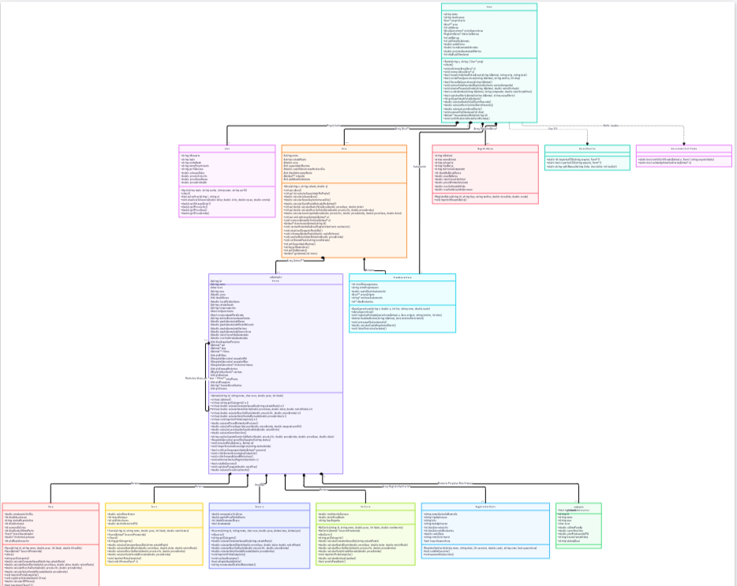

# 🐄 Sistema de Gestão - Fazenda Leiteira (FarmManager)


> **Documentação Completa (Web):** [Acesse a Especificação Interativa do Projeto](https://sites.google.com/view/sistema-de-gesto-fazenda-leite/full-page-embed)

Projeto final desenvolvido para a disciplina de **Programação Orientada a Objetos (INF 112)**, do 2º período de Ciência da Computação da Universidade Federal de Viçosa (UFV).

Este sistema visa gerenciar de forma completa os dados zootécnicos, financeiros e genealógicos de uma propriedade leiteira, utilizando os pilares da POO em C++ aplicados a problemas reais do agronegócio.

---

## 🏛️ Arquitetura e Restrições Acadêmicas

Este projeto foi desenhado sob rígidas restrições acadêmicas para nivelamento com o 2º período, focando no domínio de memória e ponteiros:

* **Sem coleções da STL (`std::vector`, `std::list`, etc):** Toda a agregação de dados utiliza **Arrays Dinâmicos Cruos** (ex: `Animal** rebanho`).
* **Gerenciamento Manual de Memória:** O projeto exige uso intensivo de `new` e `delete/delete[]`. A prevenção de *Memory Leaks* é feita rigorosamente nos destrutores das classes agregadoras e da árvore genealógica.
* **Persistência Customizada (I/O):** Leitura e escrita de arquivos (`.txt` / `.csv`) construídas "do zero" utilizando `<fstream>` e algoritmos manuais de *split/parser* de strings, sem bibliotecas externas.
* **Polimorfismo:** Uso de classes abstratas e métodos virtuais puros para delegar responsabilidades de cálculo (como consumo de ração e geração de receita) para as subclasses especializadas.

---

## 🚀 Funcionalidades e Regras de Negócio (Core)

O sistema é dividido em grandes épicos de funcionamento:

### 1. Gestão da Propriedade e Autenticação
* Sistema de login e persistência de sessão do usuário.
* Definição da área total da fazenda e cálculo da capacidade de suporte (lotação) para evitar degradação das pastagens.
* Parâmetros globais personalizáveis (ex: cotação do dólar e preço base do litro do leite).

### 2. Controle de Plantel (CRUD Polimórfico)
* Cadastro detalhado de animais com atributos base (ID, peso, idade, temperamento).
* Diferenciação polimórfica: **Vacas** (produzem leite), **Touros** (genética/corte) e **Bezerros** (fase de crescimento).
* Carga e salvamento em massa via planilhas de texto estruturado.

### 3. Sanidade e "Período de Carência"
* O animal possui um histórico de vacinas e medicamentos (`RegistroSanitario`).
* **Regra Crítica:** Se uma vaca recebe antibiótico, ela entra em "Carência". Durante esses dias, a receita gerada por seu leite é matematicamente bloqueada (zerada), refletindo as normas sanitárias reais.

### 4. Motor Econômico (Break-Even Point)
* Cruzamento de dados de despesa diária (consumo alimentar atrelado ao dólar) contra a receita gerada.
* O sistema alerta automaticamente o momento ótimo de descarte (venda) quando um animal atinge o *Break-Even* e passa a gerar prejuízo.

### 5. Genealogia e Certificação
* Mapeamento via ponteiros (`pai`, `mae`, `filhos**`) rastreando hereditariedade e doenças congênitas.
* Emissão de um **Certificado de Autenticidade e Valor**, unindo a genética do animal e os valores investidos na sua vida para fins de venda premium.

---

## 👥 Equipe e Divisão de Tarefas (Sessão CRC)

O desenvolvimento foi arquitetado em 5 módulos independentes e paralelos. Ninguém depende do código base do colega para iniciar seu módulo (integração via *mockups* e interfaces).

| Membro | Responsabilidade Técnica | Atividades Principais |
| :--- | :--- | :--- |
| **Elioenai** | *Infraestrutura e I/O* | Classe `Usuario`, login, streams (`<fstream>`), parser customizado de planilhas CSV/TXT para manipulação de strings. |
| **Paulo Vitor** | *Engine e Agregação* | Classe `Fazenda`, alocação do array dinâmico `Animal**`, cálculo de lotação vs área e liberação massiva de memória. |
| **Marco Tulio** | *Domínio e Polimorfismo* | Classe abstrata `Animal` e subclasses (`Vaca`, `Touro`, `Bezerro`). Implementação dos contratos de gasto e receita. |
| **Rhuan Machado**| *Sanidade e Economia* | Classe `RegistroSanitario`, regras do Período de Carência e laço de cálculo do Break-Even (dólar vs consumo). |
| **Victor** | *View, UI e Genealogia* | Interface gráfica/CLI (menus e interações no terminal), ponteiros de parentesco e gerador do Certificado final. |

---

## 💻 Diagrama Arquitetural de Classes

<div align="center">
  <a href="docs/Diagrama_Classes_FarmManager.pdf" target="_blank">
    
  </a>
  <br>
  <p>
    <i>Clique na miniatura acima para abrir a modelagem UML completa com zoom, ou <a href="docs/Diagrama_Classes_FarmManager.pdf">baixe o arquivo PDF aqui</a>.</i>
  </p>
</div>

## 🛠️ Como Compilar e Executar

*(Instruções genéricas a serem atualizadas conforme a estrutura final de pastas adotada pela equipe)*

1. Certifique-se de ter o compilador `g++` (GCC) instalado no seu ambiente (Windows/Linux/Mac).
2. Clone este repositório.
3. No terminal, navegue até o diretório raiz do projeto e compile os arquivos utilizando:

```bash
# Exemplo de compilação via terminal
make

execute o arquivo main gerado em ./bin com o seguinte comando:
./bin/main

ATENÇÃO DEVS
-> caso sua compilação tenha gerado muitos erros, não esqueça de usar o seguinte comando antes de compilar novamente:
make clean

-> ele foi implementado para remover todos os arquivos gerados durante a compilação
-> ao fazer alterações que não geraram erros rode apenas o make, ele vai compilar apenas os arquivos alterados e linkar na main atualizando-a


```

---
*Documentação de Engenharia concebida para a disciplina INF 112 - Universidade Federal de Viçosa (UFV).*
